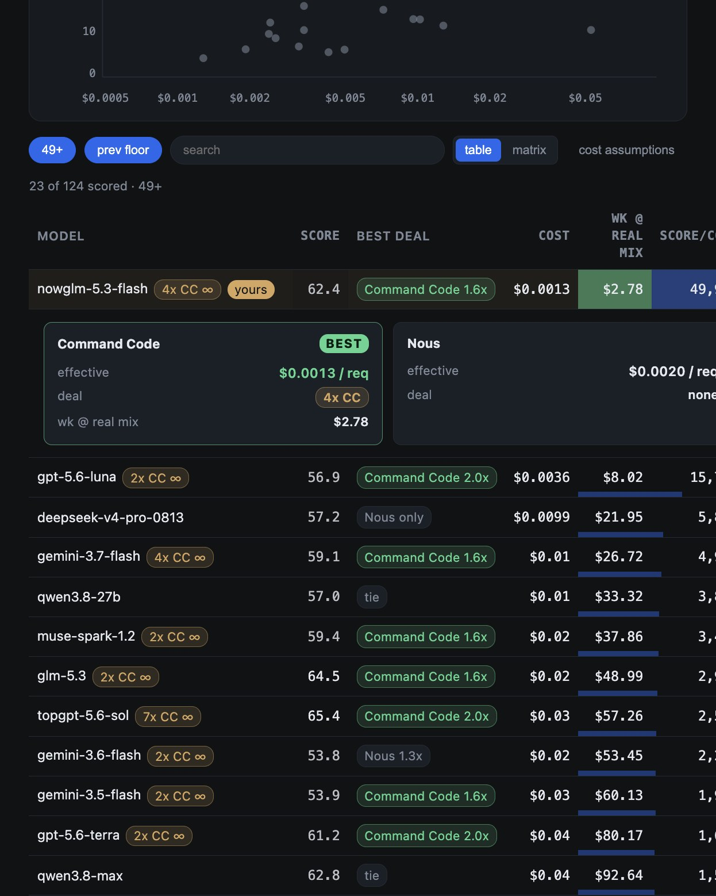

# Model Scoreboard

Live intelligence-per-cost ranking of 116+ models across the Nous catalog and
Command Code, with per-provider deal comparison. Local-first server: the API
key stays server-side, every value is pulled live from providers at refresh
time, nothing is cached in files, and no score is invented.



## What it does

- Ranks models by intelligence over cost using live artificial_analysis
  benchmarks (composite / intelligence / coding / agentic), 116+ models at
  full count. Models without a benchmark render an honest dash, never a
  made-up number.
- Two views, toggled in the filter bar:
  - **Table (default):** one compressed line per model: name, intel, best
    deal winner chip (which provider is cheaper and by how much), cost per
    request, weekly cost at real mix, ratio. Click a row to expand the
    per-provider compare: list rates, deal, effective price, weekly cost.
  - **Matrix:** providers as columns, one cell per model per provider,
    cheapest cell highlighted green, margin column states the gap.
- **What changed panel:** when score, cost, or deals move substantially
  between refreshes, an amber panel lists each change with a glyph (new,
  score up/down, cost up/down, deal added/expired, gone) and provenance
  links to the provider sources.
- Command Code-only models (present in the CC provider API but absent from
  the Nous catalog, e.g. DeepSeek V4 Flash Fast) are merged as unscored rows
  with their live CC deal price, so new models are visible immediately.
- Live deal overlay derived from the official CC pricing page: GOAT credit
  multipliers, discount percentages, expiry dates. Expired deals auto-drop.
- Real-mix weekly cost from the live CC usage summary, not a guessed profile.
- Current model (glm-5.3-flash) is the amber yours row; the delta column and
  recommendation compare against it.

## Run (manual)

```bash
cd /Users/acmac/Projects/model-scoreboard
NOUS_API_KEY="sk-nous-..." node server.mjs
# open http://127.0.0.1:8347
```

## Run (shipped, starts at login)

Managed by launchd:

- Plist: `~/Library/LaunchAgents/com.hermes.model-scoreboard.plist`
- Wrapper: `run-server.sh` loads the key from the gitignored `.env` (chmod 600)
- Behavior: `RunAtLoad` + `KeepAlive`, starts at login, respawns if it dies
- Logs: `/tmp/model-scoreboard.serve.log` and `.serve.err.log`

Restart after a backend code change (`server.mjs` / `scoreboard.mjs` /
`live-data.mjs`; frontend `index.html` edits need no restart):

```bash
launchctl kickstart -k gui/$(id -u)/com.hermes.model-scoreboard
```

## Public site (GitHub Pages)

Root `index.html` is the live board. GitHub Pages publishes `docs/`, a frozen
inline snapshot. Live pushes to `index.html` do not update the public URL.

- Live: `http://127.0.0.1:8347`
- Public: `https://anthonycho-ux.github.io/model-scoreboard/` (Pages source:
  `main` / `docs`)
- Refresh public:

```bash
node build-snapshot.mjs
git add docs/index.html
git commit -m 'Refresh public snapshot'
git push
```

Do not copy root `index.html` onto `docs/index.html`. The builder inlines
`SNAPSHOT_DATA` and strips the live `/api/scoreboard` fetch.

## Data sources (all live, no local cache)

- Nous Portal API: catalog, artificial_analysis benchmarks, list prices
- Command Code Provider API: model catalog (61 models), whoami, credits,
  subscriptions, usage summary
- Command Code official pricing page (parsed server-side): list rates, deals,
  GOAT plan budgets. `live-data.mjs` derives
  effective = list rate × planPrice / budget

## API

- `GET /api/scoreboard` — ranked rows with costs, deals, real-mix weekly cost
- `GET /api/models` — raw Nous catalog
- `GET /api/providers` — CC live snapshot (whoami / credits / plan / models)
- `GET /api/usage` — live CC usage summary
- `GET /api/recommend` — current usage + note
- `GET /api/apply/status` — current routing model and pending apply
- `POST /api/apply {model, metric}` — stage a routing change (writes nothing)
- `POST /api/apply/confirm {token}` — apply the staged model with backup

## Notes

- No popularity/trending field; recency and version aliases are the honest
  proxies.
- Intelligence source: artificial_analysis benchmarks via the live catalog.
  No score is invented; a missing benchmark is a visible dash.
- Apply writes `defaultModel` with provider `nous-portal`, the retired lane;
  future switches should target `provider: command-code`.
- Screenshot in `scoreboard.png` reflects the current UI.
